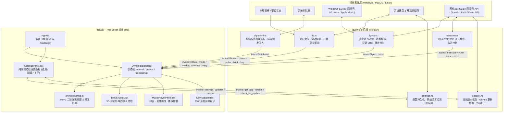

# Islandex = Island + Ex

基于 **Tauri v2 + React + TypeScript + Rust** 构建的跨平台桌面灵动岛应用，在屏幕顶部常驻一个类 iOS Dynamic Island 的纯黑悬浮岛，融合 Spring 物理果冻动效、3D 眼神交互、全局打字粒子反馈、多音源实时歌词与音乐控制（网易云音乐 `InfLink-rs` / Apple Music）、剪贴板大模型流式翻译及自动化发布流水线。

---

## 已实现功能

### 1. 顶部透明浮窗与 iOS Spring 果冻物理引擎
- **跨平台顶部居中悬浮**：启动时按主显示器物理分辨率与 DPI 缩放自动水平居中贴顶定位；无边框、纯透明、始终置顶、无系统方形阴影且不占任务栏。
- **非岛体区域鼠标穿透与防误触**：通过 Rust 全局光标追踪与 `set_ignore_cursor_events` 动态切换，透明背景区域完全穿透不遮挡其他窗口或浏览器标签页；灵动岛主窗口已禁用 WebView 默认右键菜单（不再弹出「检查」/开发者工具），同时保留设置窗输入框的正常右键体验。
- **240Hz 固定子步长 Spring 物理引擎**：
  - 宽高、圆角与内部 SVG 尺寸各自独立由欠阻尼二阶弹簧求解器驱动，支持随时打断并保留动量速度；
  - 结合实时速度计算体积守恒的果冻形变（`scaleX / scaleY / translateY`），展开与收缩均具 Q 弹回弹质感；
  - 动画静止时自动停止 `requestAnimationFrame`，空闲 CPU 占用趋近于零。
- **动态形态切换**：
  - 默认收缩无附加内容时为 `32 × 32` 纯黑**圆形岛**；
  - 当显示歌词或翻译询问等附加内容时，通过 `ResizeObserver` 实时测量布局宽度，以 Spring 动效自动拉伸为**胶囊态**（左侧圆形图标与胶囊左端半圆严格同心对齐，四边保持均匀 `4px` 黑边）；
  - 未播放音乐时悬停统一展开为经典宽比例 **iOS 胶囊态**（`300 × 128`），内部 SVG 居中放大；正在播放音乐时悬停则直接展开为**音乐控制面板**（`396 × 174`）。

### 2. Bloub 动画角色与全局鼠标微交互
- **17 套纯白/纯黑单色 SVG 动画素材**：收录 `bloub-cercle` 全套 16 种表情动画及专为翻译状态定制的思考动画（`pensif`），已统一反转为纯白球体 + 纯黑眼睛以贴合纯黑灵动岛。
- **全桌面 3D 球面眼睛凝视**：实时追踪全屏光标相对岛体中心的偏移量，利用最短弧 3D 球面旋转矩阵投影双眼 SVG `matrix(...)`，实现带真实球面透视形变与弹簧惯性的 X/Y 轴凝视追踪，并带周期性随机自然眨眼。
- **鼠标左键 Q 弹膨胀**：收缩状态下在桌面任意位置点击鼠标左键，通过脉冲弹簧注入速度冲量，岛体适度 Q 弹膨胀一次并弹性回弹（连点带冲量上限钳位）。
- **鼠标右键主动眨眼**：任意位置点击鼠标右键时，小圆球立即主动眨眼一次并重置随机自动眨眼计时。

### 3. 全局打字按键辐射动效
- 收缩状态下在任意窗口按下键盘按键时，从岛体边缘向周围 **300° 范围**（严格排除正上方 60° 扇区，避免贴顶截断）随机角度辐射出对应迷你键帽，并自动错开相邻角度。
- 键帽尺寸严格小于收缩岛体（高 `22px`、宽 `22–30px`），基于原生 Web Animations API 在 GPU 合成层完成近距离弹出、轻微漂移与清晰缓慢淡出，高速打字零 React 重渲染。

### 4. 多音源实时歌词与展开态歌曲控制面板（网易云 `InfLink-rs` + Apple Music）
- **多音源 SMTC 自动接管**：通过 Windows 原生 **SMTC**（`GlobalSystemMediaTransportControlsSessionManager`）自动识别并切换活跃播放器：
  - **网易云音乐（BetterNCM `InfLink-rs`）**：优先解析 SMTC `Genres` 中的 `NCM-{ID}` 歌曲 ID，配合高精度时间轴与网易云官方歌词接口实现精准对拍；
  - **Apple Music（Windows 官方客户端 `AppleInc.AppleMusicWin` / iTunes / Cider）**：自动拆分合并在 `Artist` 字段中的 `"歌手 — 专辑"` 信息，内置本地时钟兜底（兼容无时间轴版本）与分音源歌词提前量补偿；
  - **所有系统媒体**：可在「设置 → 通用 → 音乐来源」按需切换（自动 / 仅网易云 / 仅 Apple Music / 所有系统媒体）。
- **双源 LRC 实时歌词胶囊**：支持 **LRCLIB** 公开同步歌词库与 **网易云歌词接口**双源匹配与内存缓存；播放时收缩胶囊右侧实时滚动歌词并随句长弹性伸缩，暂停或关闭播放器后自动平滑收缩回圆形岛。
- **展开态歌曲控制面板**：正在播放音乐时将鼠标移至灵动岛，不再展示默认 Bloub SVG，而是以 Spring 果冻动效展开为类 iOS 音乐控制面板（`396 × 174`，圆角 `40px`）：
  - **高清专辑封面**：从 SMTC 缩略图分块完整读取并通过字节头魔数识别真实 MIME（内置网易云官方封面 API 兜底、切歌缓存与异常占位图标），暂停时封面优雅微缩；
  - **曲目资料与声波指示**：显示歌名、歌手 · 专辑名、当前实时歌词及动态声波动画；
  - **交互式播放进度条**：实时显示播放进度与总时长，支持点击与拖拽跳转进度（`TryChangePlaybackPositionAsync`）；
  - **真实媒体播放控制**：提供上一首、播放/暂停、下一首控制按钮（悬停内暂停后保持面板展开以便继续操作，移开鼠标再自然收起）。

### 5. 剪贴板监听与大模型流式翻译
- **剪贴板实时监听与 10 秒限时询问**：监听系统剪贴板文本更新，在收缩态胶囊中展示倒计时询问（默认 `10s`，可在设置中自定义）；若点击 `✕` 或超时未选则自动恢复为歌词胶囊或圆形岛；应用自身写入剪贴板不会重复触发询问。
- **思考动画 + SSE 流式翻译**：点击「翻译」后灵动岛自动展开为翻译面板（`420 × 252`），流式生成期间顶部居中切换为**思考版 SVG 动画**（`bloub-cercle-pensif-encre-anime.svg`），译文居中流式输出在 SVG 下方，生成完毕后切回凝视版小圆球。
- **一键复制与错误引导**：支持直接复制译文（带 `已复制 ✓` 反馈）；未配置接口或请求异常时提供清晰提示与「打开设置」快捷入口。

### 6. 系统托盘菜单、纯黑设置面板与在线更新检查
- **系统托盘**：托盘右键菜单包含 **「设置」** 与 **「退出」** 两项（左键点击托盘图标亦可打开设置）。
- **纯黑无边框侧边栏设置面板**：
  - **通用**：**开机启动**开关（Windows 写入/清理 `HKCU\Software\Microsoft\Windows\CurrentVersion\Run` 注册表项）、**音乐来源**切换及剪贴板询问超时秒数配置。
  - **翻译**：支持 OpenAI 兼容 **API Endpoint**、**API Key**（可显示/隐藏）、**模型名称**、**目标语言**（默认「自动」，通过系统区域设置自动识别本机语言，也支持手动指定多国语言）以及可自定义和一键恢复默认的**系统提示词**（支持 `{target_lang}` 占位符）。
  - **关于**：居中展示默认 Bloub SVG 图标、软件名 **`Islandex`** 与动态读取的当前版本号；提供 **「检查更新」**（查询 GitHub Releases 最新版本并进行 SemVer 对比，有新版时弹出纯黑更新弹窗并可跳转默认浏览器下载）与 **「打开 GitHub 仓库」** 按钮。
  - 所有配置持久化保存至系统应用配置目录的 `settings.json`。

### 7. GitHub Actions 自动化打包发布
- 配置 [.github/workflows/release.yml](.github/workflows/release.yml)，仅在推送 `v*` 标签（`git push origin vX.Y.Z`）时触发构建。
- 自动将 git tag 版本号同步至 `package.json`、`src-tauri/tauri.conf.json` 与 `src-tauri/Cargo.toml`，编译 **Windows 单文件免安装版 `.exe`** 并按 `Islandex-<tag>-windows-x64.exe` 命名发布至 GitHub Release，Release 更新说明自动从根目录 [CHANGELOG.md](CHANGELOG.md) 提取对应版本章节。

---

## 项目架构

### 整体架构图



### 技术栈
- **桌面框架**：Tauri v2（`tray-icon`、`macos-private-api`、`tauri-plugin-opener`）
- **后端核心**：Rust（Edition 2024）、`windows 0.62`（SMTC、`Storage_Streams`、WinHTTP、Clipboard、Registry、Globalization）、`serde` / `serde_json`
- **前端核心**：React 19、TypeScript、Vite 8、原生 Web Animations API & `ResizeObserver`
- **CI/CD**：GitHub Actions（tag 驱动 Windows 单文件便携版发布 + `CHANGELOG.md` 自动提取）

### 前后端 IPC 通信协议

| 方向 | 通道 / 命令名 | 用途说明 |
| --- | --- | --- |
| Rust → Web | `island://hover` | 通知前端灵动岛悬停展开/收缩状态变化 |
| Rust → Web | `island://cursor` | 推送全屏鼠标相对岛体中心的逻辑坐标 `(dx, dy)`，驱动 3D 凝视 |
| Rust → Web | `island://pulse` | 收缩态全局左键点击，触发岛体 Q 弹脉冲膨胀 |
| Rust → Web | `island://blink` | 全局右键点击，触发小圆球主动眨眼 |
| Rust → Web | `island://key` | 收缩态全局键盘按键事件，驱动 300° 键帽辐射 |
| Rust → Web | `island://lyric` / `island://cover` | 多音源曲目元数据、实时歌词、播放进度与切歌封面推送 |
| Rust → Web | `island://clipboard` | 剪贴板新文本内容通知，触发限时翻译询问 |
| Rust → Web | `island://translate-chunk` / `done` / `error` | 大模型 SSE 流式译文增量、完成与错误事件 |
| Web → Rust | `update_island_hitbox` / `set_island_mode` | 同步实时收缩/展开命中矩形与交互模式（`normal` / `prompt` / `translating`） |
| Web → Rust | `media_control` / `media_seek` | 控制当前活跃音乐会话上一首、播放/暂停、下一首与进度条跳转 |
| Web → Rust | `start_translation` / `cancel_translation` | 发起带单调 `requestId` 的流式翻译或中断当前请求 |
| Web → Rust | `copy_to_clipboard` | 写入系统剪贴板并记录屏蔽标记，防止重复弹窗询问 |
| Web → Rust | `get_current_lyric` / `get_current_cover` | 初始化时主动拉取当前播放曲目、歌词与专辑封面 |
| Web → Rust | `get_settings` / `save_settings` / `get_system_language` / `open_settings_window` | 读写持久化设置、读取系统默认语言及打开设置窗口 |
| Web → Rust | `get_app_version` / `check_for_update` / `open_external_url` | 读取应用版本号、检查 GitHub 最新 Release 及用默认浏览器打开链接 |

---

## 目录结构

```text
islandex/
├── .github/
│   └── workflows/
│       └── release.yml                 # git push v* 标签触发的 Windows 便携版自动打包发布工作流
├── CHANGELOG.md                        # 版本更新日志（GitHub Release 自动读取来源）
├── README.md                           # 项目说明文档
├── index.html                          # 前端入口 HTML
├── package.json                        # 前端依赖与脚本
├── tsconfig.json                       # TypeScript 配置
├── vite.config.ts                      # Vite 构建与开发服务器配置
├── public/                             # 静态公共资源
├── src/                                # 前端源码 (React + TypeScript)
│   ├── main.tsx                        # React 挂载入口
│   ├── App.tsx                         # 双窗口路由（主浮窗 / 设置面板 #/settings）
│   ├── App.css                         # 灵动岛、键帽粒子、音乐面板与翻译面板样式
│   ├── vite-env.d.ts                   # Vite 类型声明
│   ├── physics/
│   │   └── spring.ts                   # 240Hz 二阶弹簧物理引擎、形态尺寸计算与果冻脉冲
│   ├── components/
│   │   ├── DynamicIsland.tsx           # 灵动岛核心容器、状态机与全局事件接入
│   │   ├── BloubAvatar.tsx             # 3D 球面眼睛跟随与有机眨眼 SVG 组件
│   │   ├── MusicPlayerPanel.tsx        # 展开态音乐控制面板（封面、进度条、切歌/暂停控制）
│   │   ├── KeyRadiator.tsx             # 300° 迷你键帽辐射粒子组件
│   │   ├── SettingsPanel.tsx           # 纯黑侧边栏设置面板（通用 / 翻译 / 关于）
│   │   └── SettingsPanel.css           # 设置面板与更新弹窗样式
│   └── assets/
│       ├── bloubCercle.ts              # 17 套 Bloub 动画 SVG 资源映射表
│       └── bloub-cercle/               # 16 套表情动画 + pensif 思考版 SVG 动画
└── src-tauri/                          # Tauri Rust 后端
    ├── Cargo.toml                      # Rust 依赖与 Windows API 特性配置
    ├── build.rs                        # Tauri 构建脚本
    ├── tauri.conf.json                 # 窗口透明/置顶/打包配置
    ├── capabilities/
    │   └── default.json                # main 与 settings 窗口权限清单
    ├── icons/                          # 应用与托盘图标资源
    └── src/
        ├── main.rs                     # Windows Release 入口（隐藏控制台窗口）
        ├── lib.rs                      # 窗口贴顶居中、鼠标穿透、托盘菜单、全局键鼠轮询
        ├── lyrics.rs                   # 多音源 SMTC（InfLink-rs / Apple Music）、封面、双源歌词与媒体控制
        ├── clipboard.rs                # 系统剪贴板监听与防自触发写入
        ├── translate.rs                # OpenAI 兼容 SSE 流式翻译客户端
        ├── settings.rs                 # 配置读写、音乐来源、本机语言识别与开机自启管理
        └── updater.rs                  # 版本读取、GitHub Releases 更新检查与默认浏览器跳转
```

---

## 本地开发与发布

### 环境要求
- **Node.js**（推荐 LTS / v22+ 或 v24）与 **npm**
- **Rust 工具链**（`rustc` / `cargo`，需支持 Rust Edition 2024，通过 [rustup](https://rustup.rs/) 安装）
- **Windows**：Visual Studio C++ Build Tools（MSVC + Windows SDK）与 WebView2 Runtime

### 常用命令

```powershell
# 安装前端依赖
npm install

# 启动 Tauri 开发模式（PowerShell 若限制脚本策略可改用 npm.cmd）
npm run tauri dev

# 仅构建前端产物
npm run build

# 编译 Windows 单文件免安装版（产物位于 src-tauri/target/release/islandex.exe）
npm run tauri build -- --no-bundle

# 推送标签触发 GitHub Actions 自动编译发布 Release
git tag v0.1.0
git push origin v0.1.0
```

### 使用说明
1. **音乐歌词与播放控制**：
   - **网易云音乐**：安装并启用 BetterNCM 与 **`InfLink-rs`** 插件后直接播放即可同步精准歌词与控制。
   - **Apple Music（Windows 版）**：播放音乐即可自动接入封面、歌词（LRCLIB + 网易云双源匹配）、进度与切歌/暂停控制；可在「设置 → 通用 → 音乐来源」切换默认接管的播放器。
2. **剪贴板 AI 翻译**：右键系统托盘中的 **Islandex** 图标 → 点击 **「设置」** → 在 **「翻译」** 中填入 OpenAI 兼容的 API Endpoint、API Key 与模型名称并保存；之后复制任意文本即可在顶部胶囊中一键展开流式翻译并复制结果。
3. **版本检查**：在「设置 → 关于」可查看当前版本、手动检查 GitHub 最新 Release 并通过默认浏览器打开仓库。
